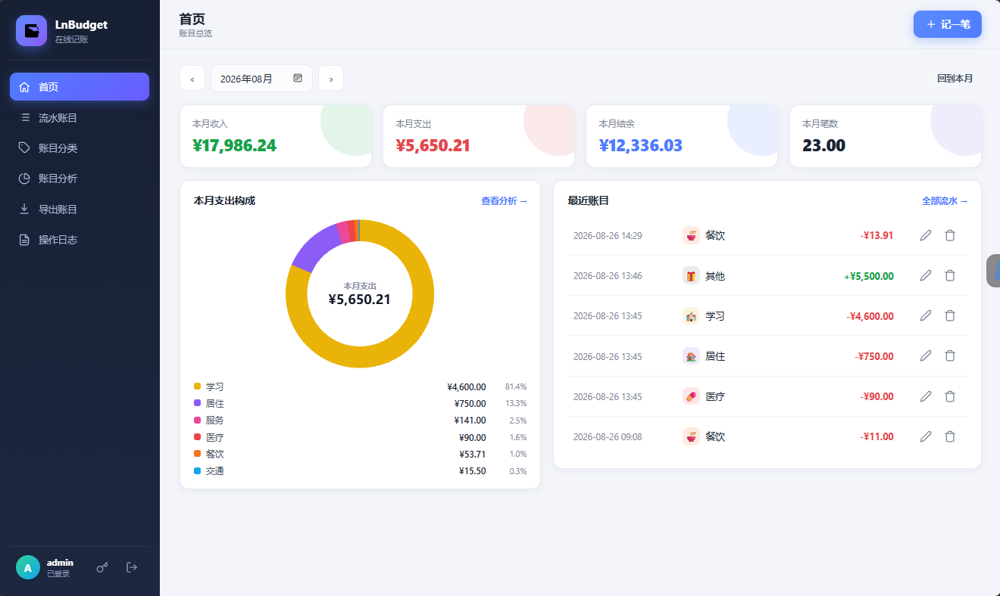
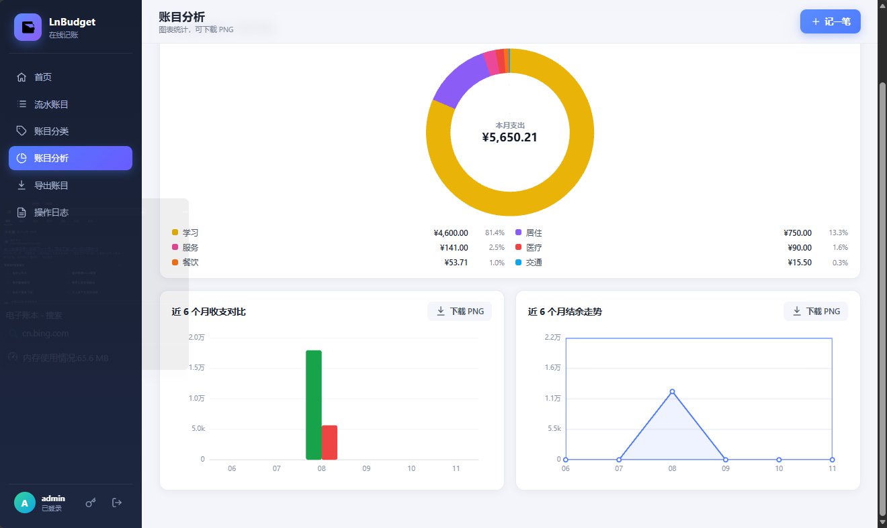

# LnBudget 在线记账

单用户个人在线记账工具，手机 / 平板 / 电脑浏览器都能用。零第三方依赖，Python 3.8+ 直接运行。

## 效果预览

| 首页 | 账目分析 |
| --- | --- |
|  |  |

## 快速开始

```bash
cp config.example.py config.py     # 1. 生成配置文件（Windows：copy）
python3 app.py                     # 2. 启动
```

浏览器访问 `http://服务器IP:8000`，本机访问 `http://127.0.0.1:8000`。

**首次登录：账号 `admin`，密码 `admin`**——登录后请立即修改密码（见下节）。

## 必做：修改初始密码

首次启动会自动创建初始账号 `admin` / 密码 `admin`，并以 PBKDF2 哈希持久化在 `data/ledger.db` 中（不写入代码或配置文件）。

登录后点击左侧栏的**钥匙图标** → 可同时修改**用户名**和**密码** → 确认后立即生效，页面自动刷新并要求用新账号重新登录（所有设备上的登录都会失效）。

- 新密码至少 8 位，建议 14 位以上、不常见的组合
- 初始密码 `admin` 是公开的，部署到局域网 / 公网前务必修改
- 端口与初始账号都在 `config.py` 修改（仅首次启动生效，之后以数据库为准）

## 常用操作

- 换端口：`python3 app.py --port 8080`
- 后台运行：`nohup python3 app.py >> data/server.log 2>&1 &`
- 备份数据：停止服务后复制 `data/ledger.db`
- 启用 HTTPS：在 `config.py` 填入 `SSL_CERT` / `SSL_KEY` 证书路径后重启即可

## 常见问题

- **忘记密码**：删除数据库中的账号记录后重启，即恢复初始账号 `admin` / 密码 `admin`：
  `python3 -c "import sqlite3; c=sqlite3.connect('data/ledger.db'); c.execute(\"DELETE FROM settings WHERE key IN ('password_hash','username')\"); c.commit()"`
- **端口被占用**：换一个端口启动
- **页面提示重新登录**：会话过期，正常现象，重新登录即可
- **公网访问**：建议启用 HTTPS；仅家庭局域网使用可以不开

## 更多文档

- 技术细节与维护知识：[PROJECT.md](PROJECT.md)
- 开发规范：[DEVELOPMENT.md](DEVELOPMENT.md)
